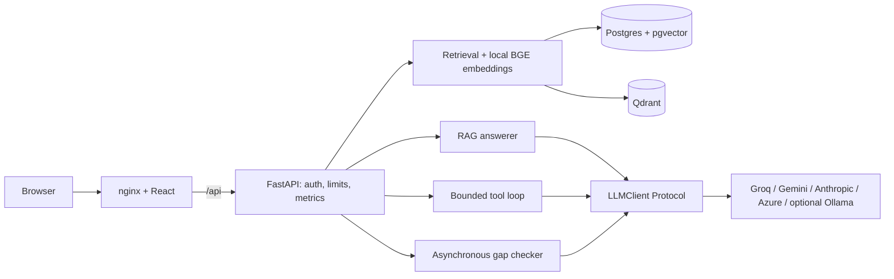

# Regulatory Docs Copilot (`labdocs`)

Search a regulatory document library, ask questions with source citations, run
bounded research tools, and compare an SOP with the corpus for conflicts and
omissions. The React interface supports upload, ingestion progress, source
inspection, asynchronous gap-check progress, cancellation and report exports.

Findings support a human review. Citation checks establish that references exist;
they do not establish that an answer is correct or that an SOP is compliant.

## Quickstart — five commands from the cloned repository

Prerequisites: Docker Engine with Compose **2.24.4 or newer**, internet access for
images/dependencies and the first embedding-model download, and a Groq or Gemini
API key with access to a tool-capable model. The server sends retrieved document
and SOP excerpts to the configured generation provider. Choose documents you
are permitted to send there.

```sh
cp .env.compose.example .env.compose
${EDITOR:-nano} .env.compose
docker compose --env-file .env.compose up --build -d --wait --wait-timeout 600
docker compose --env-file .env.compose exec backend python -m app.cli create-key --name browser --scope write
docker compose --env-file .env.compose exec backend python -m app.cli ingest --manifest data/sample/demo-manifest.csv
```

In the editor, replace the database password (use URL-safe hexadecimal), provider
URL/model and API-key placeholders. The fourth command prints a new application
key once; keep it private. Open **http://localhost:3000/settings**, paste that key
and select **Validate key**. The sample documents are synthetic software
fixtures, not regulatory authority or evaluation ground truth. Upload the real
source corpus through Documents when ready.

Compose runs migrations before one API worker starts, waits for Postgres/Qdrant
and the embedding model, and then serves the built frontend through nginx. Only
the loopback web port is published. Uploads, databases and the model cache use
named volumes. Repeating ingestion is idempotent; key names must be unique.
`docker compose --env-file .env.compose down` stops the stack while retaining
volumes. Do not add `-v` unless you intend to delete its stored data.

[Local development and tests](docs/local-testing.md) cover host-run commands,
test isolation, optional Ollama and troubleshooting. [AWS preparation](docs/aws-deploy.md)
covers external generation and deployment constraints. No cloud deployment has
been performed. [Azure](docs/azure-deploy.md) is a separate written plan.

## Browser walkthrough

1. **Settings:** validate the application key, inspect readiness and choose the
   default backend. Keys stay in `sessionStorage`; preferences contain no keys.
2. **Documents:** use a write-scoped key to upload a PDF, Markdown or TXT file
   with metadata. Follow ingestion progress and inspect rejected rows or
   cross-store synchronization warnings.
3. **Search library:** choose filters, backend and result count; open source
   snippets. The scores measure retrieval similarity, not confidence.
4. **Ask documents:** inspect the answer, citation validation status, source
   drawer, token usage and latency. Weak evidence produces explicit abstention.
5. **Research agent:** submit a question requiring search and metadata. Inspect
   each bounded tool step; time/step limits produce a visible partial result.
6. **Gap check SOP:** paste text or upload an SOP, restrict the regulation scope,
   and follow both analysis directions. Inspect each finding beside its sources,
   filter verdicts, and download JSON/Markdown or print. Read caps, unknown
   coverage and judge failures before interpreting the findings.

## Architecture



Python 3.12, FastAPI, Pydantic, SQLAlchemy/Alembic, Pandas/NumPy and
`BAAI/bge-small-en-v1.5` embeddings (384 dimensions). `VectorStore` and `LLMClient`
Protocols keep backend/provider selection in configuration. The frontend uses
React, strict TypeScript, Vite, generated API types and plain CSS.

Postgres is canonical. Ingestion writes both configured stores, with explicit
recovery warnings if Qdrant synchronization fails after the Postgres commit.
See [design decisions and limits](docs/design.md) and [platform hardening](docs/platform-hardening.md).

## API examples

Set `LABDOCS_API_KEY` in your shell to the application key, not the generation
provider key. These calls use the same nginx proxy as the browser:

```sh
curl http://localhost:3000/api/readyz
curl -H "X-API-Key: $LABDOCS_API_KEY" http://localhost:3000/api/v1/whoami
curl -H "X-API-Key: $LABDOCS_API_KEY" -H 'Content-Type: application/json' \
  -d '{"query":"What records must staff keep?","top_k":5,"backend":"pgvector"}' \
  http://localhost:3000/api/v1/search
curl -H "X-API-Key: $LABDOCS_API_KEY" -H 'Content-Type: application/json' \
  -d '{"query":"What records must staff keep?","backend":"qdrant"}' \
  http://localhost:3000/api/v1/ask
```

The schema is available at `/api/openapi.json` through nginx. The interactive
OpenAPI explorer is available at `/docs` on a directly accessed development API.
The six application views are the primary browser interface. `/metrics` stays internal
and nginx rejects `/api/metrics`.

## Evaluation status

The [committed real-store diagnostic](eval/reports/20261026T121717184366Z.md)
ran 30 queries against eight supplied documents and 238 chunks in each backend,
with no retrieval errors. These are workload/inventory measurements, not quality
scores. All 30 candidate labels remain unverified; no author-supplied clean SOPs
or reviewed mutations are available, so recall, grounding, abstention and gap
quality acceptance remain **pending**. No live Groq/Gemini quality run is claimed.

The [evaluation guide](eval/README.md) explains author review, corpus/SOP hashes,
exact-report false-positive review, provider comparisons and the separate
synthetic CI regression. README quality numbers must come from actual committed
reports; an empty denominator is unavailable, never a perfect score.

## Verification and operational limits

CI checks Python lint/format/types, backend tests with an 80% application line
coverage floor, the deterministic evaluation fixture, strict frontend types,
lint, unit tests, generated-type freshness, bundle budget and browser workflows.
A separate container job builds the production images and exercises the browser
journey through nginx with an isolated synthetic provider.

Use **one API worker and one replica**: the rate limiter is in memory and jobs
run in-process. Stored progress survives, but a process crash can strand a job;
there is no durable queue or automatic recovery. The gap token allowance bounds
admission based on conservative estimates, not arbitrary provider billing.
API keys pasted into a browser are acceptable for this demo; a public production
service needs a backend-for-frontend or OAuth and an operational security review.
